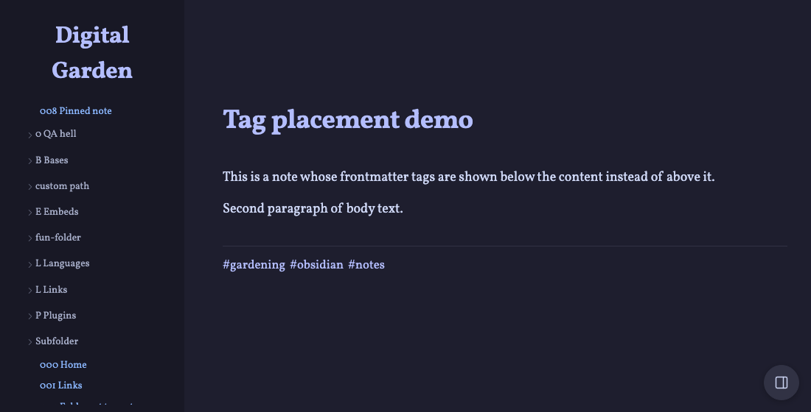

# Tag Placement

A [Digital Garden](https://github.com/oleeskild/digitalgarden) plugin that
lets you choose where a note's frontmatter tags are shown: at the top of
the note (the default without this plugin), at the bottom after the
content, or in both places.

## Settings

| Setting | Default | Description |
| --- | --- | --- |
| Tag position | `bottom` | `bottom` moves tags below the note content; `top` keeps them in the header; `both` shows them in both places. |

Can also be set via `TAG_PLACEMENT_POSITION` in the garden's `.env`.

Tags are only shown when the garden's **Show tags** setting
(`dg-show-tags`) is enabled. Bottom tags are clickable with the search
plugin, just like the header tags.

## Install

Paste this repo's URL into the plugin installer of your garden, or copy
the plugin directory into `src/plugins/tag-placement/` manually.
